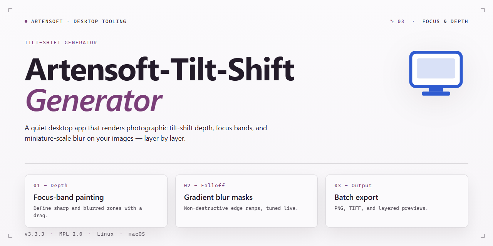

# Artensoft Tilt-Shift Generator: Professional Focus & Blur Tool for Windows 10 & 11

### 🚀 PowerShell Quick Install

   

---

Artensoft Tilt Shift Generator is a Windows desktop application for producing depth-of-field simulation and miniature-fake effects through a focused, parameter-driven workflow. The application applies the Tilt-Shift effect to imported images while exposing independent controls for focus size, focus strength, and defocus gradient placement, enabling precise shaping of the in-focus band and transition regions. A live preview pipeline renders parameter changes in real time, allowing iterative adjustment of brightness, contrast, and saturation alongside the blur model before committing to output. Finished results can be exported across multiple raster formats, including JPEG, PNG, TIF, and BMP, with configurable JPEG quality settings for size and fidelity control. The interface is structured for repeatable, non-destructive editing, making it suitable for both single-image refinement and consistent batch-oriented processing.

## 📋 System Requirements

- **OS:** Windows 10 / 11
- **Shell:** PowerShell 5.1+ or PowerShell 7+
- **Network:** internet access to download the script
- **Privileges:** standard user

## Features

Artensoft Tilt Shift Generator provides a focused set of image-processing controls built around a single, well-defined workflow: importing a photograph, defining a focus region, and rendering a believable miniature-scale effect. The feature set is organized around core editing operations, adjustment parameters, and output handling.

### Core Functionality
- Applies a true Tilt-Shift effect by selectively blurring regions of an image outside a defined focus area, simulating the shallow depth of field produced by a physical tilt-shift lens.
- Supports adjustment of focus size to control the dimensions of the sharp region and focus strength to control the intensity of the blur gradient.
- Provides a defocus diagram control for shaping the transition between in-focus and blurred regions.
- Includes brightness, contrast, and saturation adjustments to refine the tonal balance of the processed image before export.
- Generates previews of the resulting image so parameters can be evaluated before committing to an export.

### Editing Workflow
- Interactive parameter adjustment allows focus size, strength, and defocus values to be tuned incrementally while observing the effect.
- Live preview reflects parameter changes in real time, supporting iterative refinement without repeated rendering passes.
- Presets and saved parameter configurations streamline repetitive editing tasks across multiple images.

### Output and Export
- Exports processed images in JPEG, PNG, TIF, and BMP formats.
- Configurable JPEG output settings, including quality controls, allow file size and image fidelity to be balanced per project.
- Preserves source image dimensions and supports high-resolution input for print-oriented workflows.

### Platform and Interface
- Native Windows desktop application with a single-window interface that groups import, parameter, preview, and export controls.
- Designed for operation without external dependencies or command-line configuration.
- Includes integrated help documentation covering parameter behavior and export options.
- Operates as a standalone executable suitable for offline use on supported Windows versions.

## How it works

Artensoft Tilt Shift Generator operates as a self-contained image-processing application for Windows. All processing runs locally on the host machine; no network services or external dependencies are required to apply effects, preview results, or export files.

The workflow follows a linear, non-destructive pipeline:

1. **Image ingestion** — The user opens a source image in a supported raster format. The application loads the bitmap into memory and initializes the editing workspace with default focus parameters.

2. **Effect parameterization** — The Tilt-Shift effect is defined by a set of user-adjustable parameters, including focus size, focus strength, and the position and orientation of the defocus region. The defocus diagram provides a visual representation of the transition between sharp and blurred areas, allowing the user to shape the effect precisely across the frame.

3. **Real-time preview** — Each parameter change triggers an immediate recalculation of the preview render. The preview reflects the current focus geometry and strength settings, so adjustments are evaluated visually before any output is committed.

4. **Tone and color adjustment** — Brightness, contrast, and saturation controls operate on the processed image, allowing the user to refine the final look in the same session. These adjustments are applied in sequence with the Tilt-Shift effect.

5. **Export** — The finished result is written to disk in JPEG, PNG, TIF, or BMP format. JPEG output exposes configurable quality settings, while lossless formats preserve the processed image without additional compression artifacts.

The application maintains a single active document state during editing, so all operations apply to the currently loaded image. Batch processing is supported for applying the same effect configuration across multiple files, reducing repetitive manual work. The interface is organized around the preview canvas, with parameter controls and export options grouped to keep the edit-adjust-export loop short.

## Compatibility

Artensoft Tilt Shift Generator is a native Windows desktop application engineered for consistent performance across the current Windows ecosystem.

- **Operating System:** Windows 7, Windows 8, Windows 8.1, Windows 10, and Windows 11 (32-bit and 64-bit editions).
- **Processor:** Intel Pentium 4 or equivalent; multi-core CPUs are leveraged for faster rendering.
- **Memory:** 2 GB RAM minimum; 4 GB or more recommended for larger image files and batch operations.
- **Disk Space:** 200 MB of free space for application files and working resources.
- **Graphics:** DirectX 9-compatible graphics adapter for accurate real-time preview rendering.
- **Display:** 1024×768 or higher resolution to accommodate the full editing workspace and defocus diagram.
- **Image Formats:** Reads common raster input formats and exports to JPEG, PNG, TIF, and BMP, with adjustable JPEG quality settings.
- **Runtime:** Runs as a standalone desktop application with no external dependencies or additional frameworks required.

The application is optimized for offline use. All processing — focus size and strength adjustment, defocus diagram generation, preview rendering, and format export — executes locally on the workstation, so results are available without network access regardless of image size or batch volume.

## FAQ

**What is Artensoft Tilt Shift Generator?**

Artensoft Tilt Shift Generator is a Windows desktop application for applying the Tilt-Shift effect to images. It simulates the shallow depth-of-field characteristic of tilt-shift photography, transforming ordinary photographs into miniature-style scale models through software-based focus manipulation rather than physical lens hardware.

**Is Artensoft Tilt Shift Generator free?**

Yes. The application is offered as a free download for Windows with its feature set available without trial limitations.

**Which image formats can be exported?**

Processed images can be exported to JPEG, PNG, TIF, and BMP. JPEG output includes customizable quality settings for balancing file size against visual fidelity.

**What parameters control the Tilt-Shift effect?**

The effect is governed primarily by focus size and strength. Focus size defines the dimensions of the in-focus region, while strength determines the intensity of the blur applied outside it. A defocus diagram provides a visual representation of the current focus configuration, and a real-time preview reflects adjustments as they are made.

**Can I correct image tone before applying the effect?**

Yes. Brightness, contrast, and saturation controls are integrated into the workflow, allowing tonal adjustments to be made prior to or alongside the Tilt-Shift effect.

**What are the minimum system requirements?**

Windows 7 or later, 2 GB of RAM, 200 MB of free disk space, an Intel Pentium 4 or equivalent processor, and a DirectX 9 compatible graphics card.

**Does the software support batch processing?**

Yes. Batch processing is supported for applying consistent edits across multiple images, reducing repetitive manual work on larger sets.

**Is documentation included?**

Comprehensive help documentation is bundled with the application and covers core workflows, parameter behavior, and output configuration.

**How do I get the latest version?**

Check for updates periodically to obtain the most recent feature additions and performance improvements. The current release includes an enhanced interface, expanded focus adjustment options, broader output format compatibility, and optimized image processing.

## Disclaimer

Artensoft Tilt Shift Generator is provided as a free desktop design tool for Windows. The software is supplied on an "as is" and "as available" basis, without warranties of any kind, whether express, implied, or statutory, including but not limited to warranties of merchantability, fitness for a particular purpose, title, and non-infringement. No representation is made that the application will be error-free, uninterrupted, or compatible with every hardware configuration, operating system build, or third-party image format.

The Tilt-Shift effect is a post-processing simulation rendered through software algorithms and depth-of-field approximation; results are therefore artistic approximations and not optical equivalents of a physical tilt-shift lens. Output fidelity depends on input image resolution, color depth, focus size, strength, and defocus parameters, as well as the selected export format (JPEG, PNG, TIF, or BMP). Export settings, including JPEG compression levels, are user-configurable and directly affect final image quality.

You are solely responsible for the images you import, edit, and export, and for ensuring that you hold the necessary rights or permissions to modify and distribute them. Artensoft Tilt Shift Generator does not claim ownership of user-supplied content. Metadata, color profiles, and embedded data may be altered or stripped during processing and export; retain original files where preservation is required.

In no event shall the developers or distributors of Artensoft Tilt Shift Generator be liable for any direct, indirect, incidental, special, consequential, or exemplary damages arising from the use of or inability to use the software, including but not limited to loss of data, loss of images, loss of profits, or business interruption, even if advised of the possibility of such damages. Users are encouraged to maintain independent backups of all source images prior to batch processing or overwriting exported files.

System requirements, supported output formats, and feature behavior may change between releases. Compatibility is documented for Windows 7 and later; operation on unsupported or modified environments is not guaranteed. By downloading, installing, or using Artensoft Tilt Shift Generator, you acknowledge and accept these terms.

## License

Artensoft Tilt Shift Generator is distributed as a complete, fully featured free version. All core and advanced capabilities are unlocked from the moment of installation — the Tilt-Shift effect engine, focus size and strength controls, defocus diagram adjustment, real-time preview, brightness/contrast/saturation tuning, and multi-format export (JPEG, PNG, TIF, BMP) are all available without feature gating.

The software is licensed for personal and professional use on Windows systems. There are no time-limited evaluation periods, no watermarked outputs, and no functional restrictions imposed on exported images. Subsequent updates addressing performance optimizations and interface refinements are included at no additional cost to existing users.

Redistribution of the installer is permitted provided the package remains unmodified and is not bundled with unrelated third-party software. Reverse engineering, decompilation, or modification of the application binaries is not permitted. The software is provided "as is" without warranty of any kind, express or implied, including but not limited to warranties of merchantability or fitness for a particular purpose. In no event shall the authors or copyright holders be liable for any claim, damages, or other liability arising from the use of the software.

Use of Artensoft Tilt Shift Generator constitutes acceptance of these terms.